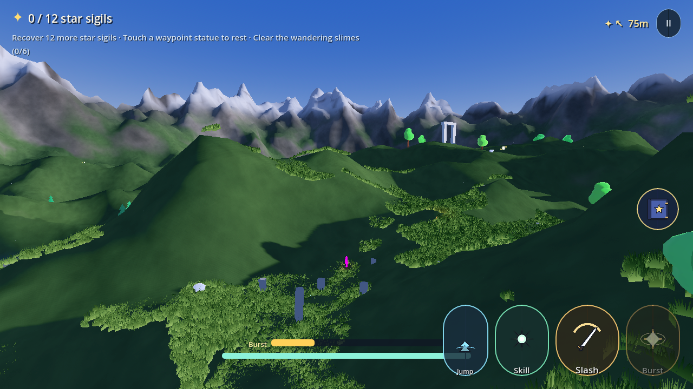
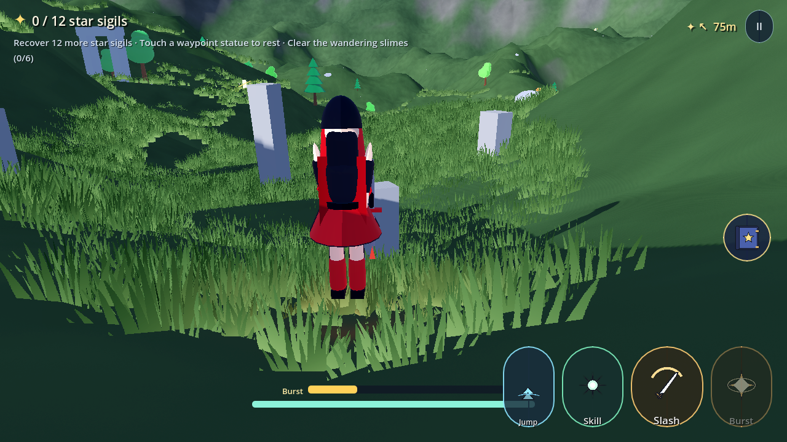
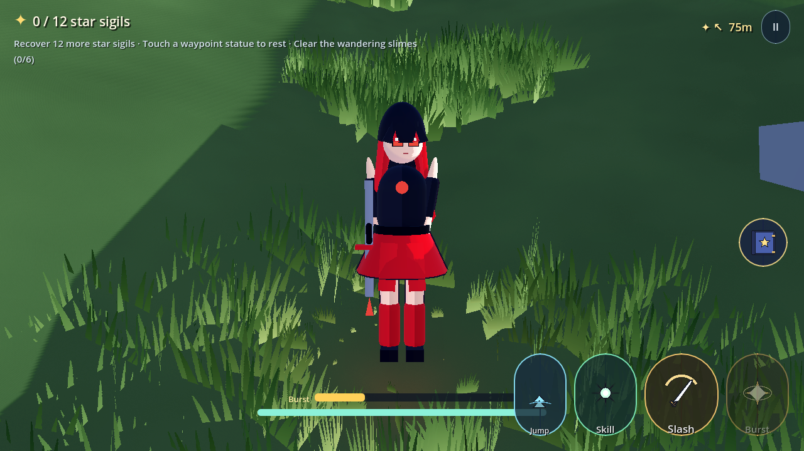

# LastStar

**An open-world, cel-shaded action-RPG inspired by _Genshin Impact_ — built with Godot 4.3, targeting Android first.**

LastStar started life as a fork of the MIT-licensed Godot 4 open-world prototype
[`flips100/realistic-open-world`](https://github.com/flips100/realistic-open-world)
(procedural terrain + vegetation + third-person controller), and has been rebuilt into an
anime-styled action RPG: a toon-shaded party of three elemental characters, gliding, elemental
skills and bursts, slimes with elemental reactions, star-sigil hunting and waypoint statues —
all rendered with a mobile-friendly renderer and shipped through an automatic CI pipeline that
produces an installable APK on every push.

> **This is an original, fan-inspired project.** It contains **no Genshin Impact assets** — no
> characters, models, textures, audio or data. Everything you see is generated procedurally in
> GDScript (meshes, materials, textures, sound effects) or is permissively licensed code.
> "Genshin Impact" is a trademark of HoYoverse; this project is not affiliated with them.

-5ac8fa)  

---

## ✨ What's in the game

| System | Details |
|---|---|
| **Renderer** | OpenGL ES 3.0 (Compatibility) — runs on every Android device since 2013, including PowerVR GPUs like the Helio P95 where the Vulkan path black-screens |
| **Anime terrain** | 900 m procedural valley, 144² heightfield, custom `terrain_anime` shader: painterly banded meadow, slope-aware rock, wet shoreline and snow caps |
| **Cel shading** | `anime_toon.gdshader` — world-space two-band ramp, cool tinted shadows, a small cool rim + inverted-hull outline pass. No specular lobe: on near-black cloth it only ever painted grey patches, so the ramp and the outline carry the form |
| **Party of three** | Sora (Anemo, sword), Ember (Pyro, catalyst), Volt (Electro, bow). Switch instantly with **T** or the portrait row |
| **Traversal** | Sprint with stamina, double jump, **gliding** with wind wings, plunge attack from a dive |
| **Combat** | 3-hit melee combo, elemental skill (E) with cooldown, elemental burst (Q) that spends energy, damage numbers, hit flashes, shockwaves |
| **Enemies** | Elemental slimes that hop at you and take **reaction multipliers** (same element resisted, opposite empowered) |
| **Progression** | 12 star sigils to recover, waypoint statues that heal the party and set your respawn, quest tracker, victory banner |
| **World dressing** | Lake with stylized wave shader, wind arches, glowing crystal formations, campfires, rolling clouds, 3 700+ instanced trees/rocks/flowers and a 2 600-blade swooshing grass carpet |
| **Day / night** | Sun angle, colour and ambient light drift over time; campfire and crystal lights carry the night |
| **Environment (rendered)** |   |
| **Character (rendered, front)** |  |
| **Grass** | A streaming meadow over the whole valley: 26 m chunks rebuilt around the player out to 130 m, density falling off with distance (9,000 / 3,600 / 1,100 blades per chunk), ~80,000 instances at full quality. Wind-waved, per-instance colour variation, root-to-tip gradient and faked subsurface scattering |
| **Mobile UI** | Touch joystick + right-side camera drag + on-screen action buttons, plus a **Quality** toggle (Balanced / Performance / High) |

### Controls

| Action | Keyboard / mouse | Touch |
|---|---|---|
| Move | WASD | Left joystick |
| Camera | Mouse | Drag the right side of the screen |
| Sprint | Shift | — |
| Jump / double jump / glide | Space (hold in the air) | Jump button |
| Attack | Left mouse | Slash button |
| Elemental skill | E | Skill button |
| Elemental burst | Q | Burst button |
| Switch character | T | — |
| Spell wheel | 1–5 | Book button (right), then tap a slot |
| Assign a spell | — | Long-press a spell slot |
| Pause | Esc | II button |

---

## 📱 Install the app (Android)

**One-click download — always the newest build:**

## ⬇️ [**Download LastStar.apk**](https://github.com/Endiq-jar/LastStar/releases/download/latest-apk/LastStar.apk)

Every push to the repository builds a fresh APK and re-uploads it to the rolling
[`latest-apk`](https://github.com/Endiq-jar/LastStar/releases/tag/latest-apk) release, so that
URL never goes stale. To install:

1. Open the link above on an Android phone (Android 7.0 or newer).
2. Allow "install unknown apps" for your browser / file manager when prompted.
3. Open `LastStar.apk` and install, then launch **LastStar**. It runs fully offline.

You can also grab the **`LastStar-android`** artifact from the **Actions** tab, or
tagged builds (`git tag v1.0.0 && git push --tags`) publish a **GitHub Release** with the
APK, a Linux build and a Windows build attached.

**Requirements:** arm64-v8a device, Android 7.0+ (API 24), ~25 MB download. Renderer: Mobile
(Vulkan), landscape, touch joystick + action buttons.

## 🩺 Rendering safety net

The game is written so it **cannot** show a black screen with only the HUD:

* the player (and therefore the camera) is built **first**; all optional scenery
  is dressed on afterwards,
* the character rig is built *after* the camera and every rig accessor is
  null-safe, so a rig problem can't stop rendering,
* `world.tscn` ships a real `Environment`, the sun never drops below the
  horizon, and ambient light has a floor - the valley stays lit,
* a deferred fallback camera is installed if the viewport somehow has none,
* a render watchdog samples the first frames and calls `repair_render()` if the
  view comes out black,
* **Pause menu → "Repair view"** rebuilds the camera, environment and lights on
  demand, and quality tiers are reversible and remembered in `user://video.cfg`.
* an automatic tuner samples real frame time on startup and drops to the
  Performance tier on weak hardware, and vegetation beyond ~190 m is culled.
* the world bootstrap contains **no coroutines and no GPU readbacks** — both
  could wedge the main loop on software/GL drivers.

CI enforces all of it: `tests/render_probe.tscn` actually renders the world under
Xvfb, screenshots the framebuffer and measures mean luminance, non-black coverage
and distinct colour count. A build fails if the 3D view is genuinely black, and
the screenshots are uploaded as the `render-probe` artifact on every run.

### Release signing (optional)

Without configuration the CI ships a *debug-signed* APK that installs fine on any device.
To ship a proper release APK, add these repository secrets
(*Settings → Secrets and variables → Actions*):

| Secret | Value |
|---|---|
| `ANDROID_KEYSTORE_BASE64` | `base64 -w 0 release.keystore` |
| `ANDROID_KEYSTORE_USER` | key alias |
| `ANDROID_KEYSTORE_PASSWORD` | keystore + key password |

The workflow then builds `--export-release` with your keystore automatically.

---

## 🛠 Build it yourself

Requirements: **Godot 4.3** (standard, not .NET) and, for Android, the Android SDK + JDK 17.

```bash
git clone https://github.com/Endiq-jar/LastStar.git
cd LastStar
godot --headless --editor --quit          # import assets once
godot                                     # play in the editor, F5

# Android
godot --headless --install-android-build-template \
      --export-debug "Android" build/android/LastStar.apk
```

`export_presets.cfg` ships three presets: **Android** (arm64-v8a), **Linux**, **Windows Desktop**.

---

## 🗂 Project layout

```
project.godot              Mobile renderer, input map, autoload "Game"
export_presets.cfg         Android / Linux / Windows presets
default_env.tres           Fallback environment
scenes/
  main_menu.tscn           Title screen (live 3D diorama)
  world.tscn               Terrain + vegetation + HUD
  ui/hud.tscn              HUD root
scripts/
  game_state.gd            Autoload: party, HP/energy/stamina, sigils, waypoints, quality
  character_builder.gd     Procedural anime character rigs (toon + outline shaders)
  terrain_generator.gd     Heightfield + trimesh collision + lake bowl + rim mountains
  vegetation_spawner.gd    MultiMesh grass, trees, rocks, flowers
  world.gd                 Environment, day/night, landmarks, spawns
  player.gd                Movement, glide, combat, party switching, touch camera
  slime.gd                 Enemy AI + elemental reactions
  sigil.gd / waypoint_statue.gd
  hud.gd / touch_controls.gd
  fx.gd                    Tweened procedural VFX
shaders/
  anime_toon.gdshader      Cel shading + rim + specular band
  outline.gdshader         Inverted-hull outline
  terrain_anime.gdshader   Painterly triplanar terrain
  water_anime.gdshader     Stylized lake
  grass_sway.gdshader      Wind-swept MultiMesh grass
.github/workflows/build.yml  Auto-build APK + desktop, publish releases
```

### Tuning performance

Open the pause menu and press **Quality**, or edit `Game.quality_tier` (0 Balanced,
1 Performance, 2 High). For deeper tuning: `VegetationSpawner` counts, `TerrainGenerator.RESOLUTION`,
`RenderingServer.directional_shadow_atlas_set_size`.

---

## 📜 Credits & licence

* **Code:** MIT — see [LICENSE](LICENSE) and [CREDITS.md](CREDITS.md).
* **Forked base:** [`flips100/realistic-open-world`](https://github.com/flips100/realistic-open-world) (MIT)
  — the procedural terrain, vegetation scatter and third-person prototype this project grew from.
* **Rendering techniques** (toon ramp, SSR-free stylized water, MultiMesh wind grass) are original
  GDScript/GLSL written for this project.
* Inspired by *Genshin Impact* (© HoYoverse). No HoYoverse assets are included or required.
